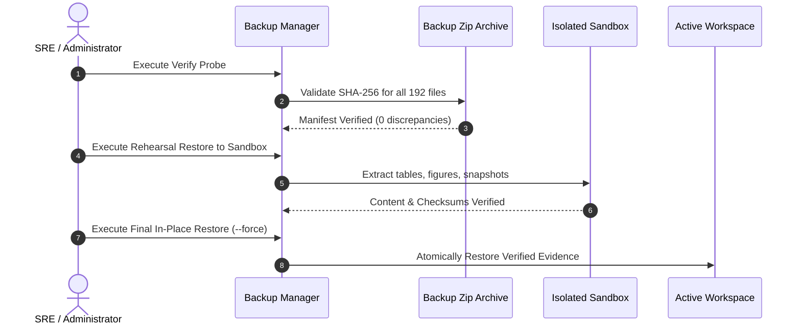

# Backup, Recovery & Data Protection Runbook

**System**: Transaction Fraud Detection Analytics Platform & Power BI Simulation  
**Document**: Standard Operating Procedure (SOP) — Data Backup, Verification & Recovery  
**Audience**: Database Administrators, Site Reliability Engineers, and Storage Operations  

---

## 1. Scope & Protection Objectives

This document defines the operational procedures for creating, verifying, scheduling, and restoring backup archives for the **Transaction Fraud Detection Analytics Platform**.

### Recovery Point Objective (RPO)
- **Pre-deployment**: 0 seconds (a verified backup is taken immediately prior to any software deployment or data refresh).
- **Scheduled Operations**: Daily (captures newly created historical snapshots and run telemetry).

### Recovery Time Objective (RTO)
- **Target RTO**: $< 3$ minutes to extract and verify the 192-file canonical evidence package.

---

## 2. Backup Operations

All backup operations are driven by `scripts/backup_manager.py`.

### 2.1 Creating an On-Demand Backup
```powershell
# Create an on-demand backup with a custom label
python scripts/backup_manager.py --action create --label "pre_refresh"
```
*Output:*
- Produces `backups/backup_YYYYMMDD_HHMMSS_pre_refresh.zip`.
- Computes SHA-256 for all 192 included files and embeds `backup_manifest.json`.
- Emits `backups/backup_YYYYMMDD_HHMMSS_pre_refresh.zip.sha256`.

### 2.2 Listing Existing Backups
```powershell
python scripts/backup_manager.py --action list
```
Displays all archives in `backups/`, their creation timestamps, size in megabytes, and file counts.

### 2.3 Cryptographically Verifying an Archive
Before restoring or archiving to cold storage, confirm that the archive has not suffered bit rot or corruption:
```powershell
python scripts/backup_manager.py --action verify --archive backups/backup_20261021_180458_phase7_baseline.zip
```
*Expected output:* `{"status": "VERIFIED_INTEGRITY", "verified_files": 192}`.

---

## 3. Disaster Recovery & Restoration Procedures



### Scenario A: Rehearsal & Verification in Isolated Sandbox (Recommended)
Always rehearse restoration in an isolated scratch directory without altering active files:
```powershell
python scripts/backup_manager.py --action restore --archive backups/backup_20261021_180458_phase7_baseline.zip --target-dir backups/rehearsal_sandbox
```
Inspect `backups/rehearsal_sandbox/tables/` to verify restored tables.

### Scenario B: Emergency Production Restoration
If active tables or figures have been corrupted or accidentally deleted:
1. Stop the application server:
   ```bash
   docker compose down
   # or stop python scripts/server.py
   ```
2. Restore directly into the workspace root:
   ```powershell
   python scripts/backup_manager.py --action restore --archive backups/backup_20261021_180458_phase7_baseline.zip --target-dir . --force
   ```
3. Regenerate the client data layer:
   ```powershell
   python analytics/build_dataset.py
   ```
4. Restart application and verify data readiness probe:
   ```powershell
   python scripts/server.py
   python scripts/health_check.py --type data
   ```

---

## 4. Retention Policy & Storage Controls

The backup manager automatically enforces retention pruning:
- Default retention count: `10 archives`.
- Older archives are deleted when a new backup is created, preserving storage capacity.
- To configure retention, set `MAX_BACKUP_COUNT` in `.env` (e.g. `MAX_BACKUP_COUNT=20`).
