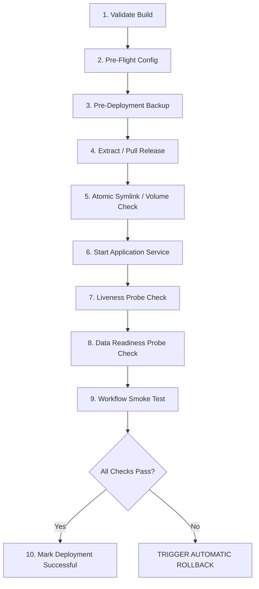

# Deployment & Operations Runbook

**System**: Transaction Fraud Detection Analytics Platform & Power BI Simulation  
**Document**: Standard Operating Procedure (SOP) — Production Deployment & Rollback  
**Audience**: Site Reliability Engineers (SRE), Platform Operations, and System Administrators  

---

## 1. Scope & Operating Context

This runbook defines the controlled, step-by-step deployment and emergency rollback procedure for the **Transaction Fraud Detection Analytics Platform**.

The platform is designed to run in two primary production contexts:
1. **Containerized Production**: Multi-stage Docker container deployed to an internal container host, Kubernetes pod, or on-premise Docker engine.
2. **Dedicated Host / Workstation**: Python-managed operational HTTP process running directly on Linux, Windows Server, or macOS.

---

## 2. Pre-Deployment Verification Checklist

Before initiating any deployment or upgrade, verify the following prerequisites:

- [ ] **Artifact Check**: The candidate release zip or Docker image tag has been validated and cryptographically hashed.
- [ ] **Configuration Check**: Production environment variables are set or `.env` has been populated from `.env.example`.
- [ ] **Data Safety Check**: A verified pre-deployment backup has been executed and confirmed (`python scripts/backup_manager.py --action create`).
- [ ] **Network Port Binding**: Port `4173` (or configured `APP_PORT`) is available and not bound by zombie processes.
- [ ] **Storage Permissions**: Process user (UID 10001 or host service account) has write access to `logs/`, `backups/`, and `app/public/data/snapshots/`.
- [ ] **Mathematical Regression**: 100% of mathematical metric checks passed on the candidate build.

---

## 3. Ten-Stage Deployment Sequence



### Stage 1: Validate Candidate Build
Confirm that the release artifact matches the expected SHA-256 digest:
```powershell
python scripts/build_release.py --validate-only
```

### Stage 2: Verify Configuration
Execute pre-flight environment assertion:
```powershell
python scripts/config_loader.py --validate
```

### Stage 3: Execute Pre-Deployment Backup
Archive current durable state (snapshots, logs, tables) before applying updates:
```powershell
python scripts/backup_manager.py --action create --label "pre_deploy_v1.0.0"
```
Confirm the backup file exists in `backups/` and its manifest verified.

### Stage 4: Build or Pull Release
- **For Docker Deployments**:
  ```bash
  docker compose build
  ```
- **For Non-Containerized Deployments**:
  ```powershell
  cd app && npm.cmd run build && cd ..
  ```

### Stage 5: Apply Directory & Volume Permissions
Ensure persistent mount directories exist with proper access:
```powershell
New-Item -ItemType Directory -Force -Path logs, backups, app\public\data\snapshots
```

### Stage 6: Start Candidate Release
- **For Docker**:
  ```bash
  docker compose up -d
  ```
- **For Host Process**:
  ```powershell
  python scripts/server.py
  ```

### Stage 7: Check Process Liveness
Poll the liveness health endpoint:
```powershell
python scripts/health_check.py --type liveness
```
*Expected output:* `LIVENESS: OK (HTTP 200 - Server process responsive)`

### Stage 8: Check Data Readiness
Verify that all 46 CSV tables, static JSON layers, and figures are readable:
```powershell
python scripts/health_check.py --type data
```
*Expected output:* `DATA READINESS: OK (46 tables verified, manifest checked, snapshots intact)`

### Stage 9: Execute Smoke Test
Query the operational status API and verify key metrics:
```powershell
Invoke-RestMethod -Uri "http://127.0.0.1:4173/api/status"
```

### Stage 10: Sign-Off
Record deployment timestamp, version, and operator initials in `logs/deployment_history.log`.

---

## 4. Emergency Rollback Runbook

If any health check fails in Stage 7, 8, or 9, or if critical data corruption is observed:

### Step 1: Immediate Process Termination
```powershell
# Stop container service
docker compose down
# Or stop standalone Python server (Ctrl+C / Stop-Process)
Get-Process -Name python -ErrorAction SilentlyContinue | Where-Object { $_.CommandLine -like "*scripts/server.py*" } | Stop-Process -Force
```

### Step 2: Restore Durable State from Backup
Restore the verified pre-deployment backup archive:
```powershell
python scripts/backup_manager.py --action restore --archive backups/backup_pre_deploy_v1.0.0.zip
```

### Step 3: Revert Application Bundle
If a previous release bundle was replaced, re-extract the prior release zip (`dist-release/fraud-analytics-console-v{previous}.zip`).

### Step 4: Restart Previous Release
```powershell
python scripts/server.py
```

### Step 5: Post-Rollback Health Audit
Execute full health check to confirm recovery:
```powershell
python scripts/health_check.py --type all
```

### Step 6: Incident Logging
Document the root cause of failure in `logs/incident_log.md`.
