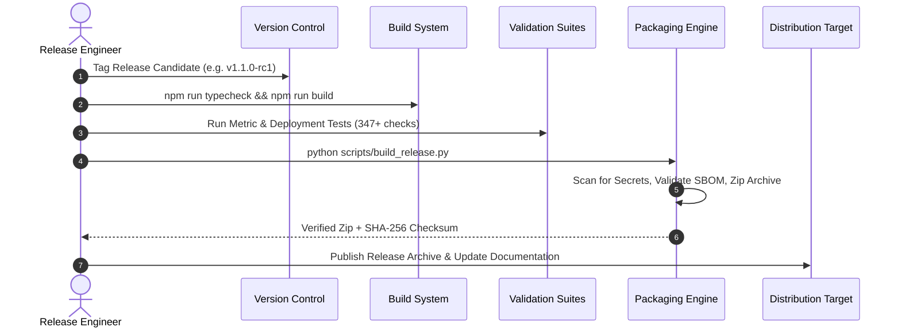

# Release Process & Release Candidate Runbook

**System**: Transaction Fraud Detection Analytics Platform & Power BI Simulation  
**Document**: Standard Operating Procedure (SOP) — Production Release Lifecycle  
**Audience**: Release Managers, DevOps Engineers, and Quality Assurance Leads  

---

## 1. Overview & Release Cadence

This runbook specifies the end-to-end procedure for packaging, validating, approving, and releasing candidate builds of the **Transaction Fraud Detection Analytics Platform**.

Releases follow semantic versioning (`vMAJOR.MINOR.PATCH`). Every candidate build must pass all automated quality gates, security audits, and mathematical regression suites before a release bundle is finalized.

---

## 2. Release Candidate Preparation Sequence



### Step 1: Pre-Release Code Freeze & Branch Tagging
1. Ensure the working directory has no uncommitted changes.
2. Verify version string in `app/package.json`:
   ```bash
   # Confirm version
   cat app/package.json | grep version
   ```

### Step 2: Full Test & Mathematical Audit
Execute all four verification suites from the workspace root:
```powershell
# 1. Strict TypeScript check
cd app && npm.cmd run typecheck && cd ..

# 2. Production bundling
cd app && npm.cmd run build && cd ..

# 3. Mathematical metric integrity (196 checks)
python tests/validate_metrics.py

# 4. Phase 2 contract and schema assertions (144 checks)
python tests/validate_phase2.py

# 5. Phase 6 data refresh engine assertions (7 checks)
python tests/validate_phase6_engine.py

# 6. Phase 7 deployment, health check & backup assertions
python tests/test_phase7_deployment.py
```
**Gate Requirement**: 100% of checks must pass. Zero failures or unhandled exceptions permitted.

### Step 3: Package Build & Security Inspection
Run the release packaging automation:
```powershell
python scripts/build_release.py
```
This script automatically:
1. Audits candidate files against forbidden patterns (`.env`, `*.key`, `node_modules`, `*.log`, `.staging`).
2. Scans text files for potential AWS keys, passwords, or authentication tokens.
3. Generates a Software Bill of Materials (`sbom.json`) cataloging all npm and PyPI dependencies.
4. Produces `dist-release/fraud-analytics-console-v{version}.zip`.
5. Calculates the SHA-256 digest and writes `dist-release/fraud-analytics-console-v{version}.zip.sha256`.

### Step 4: Checksum Verification
Verify the cryptographic hash of the generated release package:
```powershell
# Verify SHA-256 in PowerShell
Get-FileHash dist-release\fraud-analytics-console-v1.0.0.zip -Algorithm SHA256
```
Compare with `dist-release\fraud-analytics-console-v1.0.0.zip.sha256`.

---

## 3. Release Package Contents & Bill of Materials

The generated release zip bundle contains:
- `app/dist/`: Minified, chunk-split production static assets and HTML entry point.
- `tables/`: All 46 canonical CSV analytical evidence tables.
- `figures/`: 129 PNG figures and 7 interactive Plotly HTML maps.
- `scripts/`: Production operational server (`server.py`), health probe (`health_check.py`), configuration loader (`config_loader.py`), backup manager (`backup_manager.py`), and storage manager (`storage_manager.py`).
- `release_manifest.json`: Complete file manifest with per-file SHA-256 digests.
- `sbom.json`: Machine-readable dependency bill of materials.
- `Dockerfile` & `docker-compose.yml`: Multi-stage container definitions.
- `.env.example`: Sanitized environment template.

---

## 4. Release Rollback Procedure

If a deployed release displays unexpected behavior or data issues in production:
1. **Immediate Action**: Stop the running container or process:
   ```bash
   docker compose down
   # or terminate python scripts/server.py
   ```
2. **Restore Previous Release Archive**:
   Extract the previously verified release zip into the application directory.
3. **Restore Durable Snapshots**:
   Restore historical snapshots from the pre-deployment backup using:
   ```powershell
   python scripts/backup_manager.py --action restore --archive backups/pre_deploy_backup.zip
   ```
4. **Restart & Re-verify**:
   Start the operational server and verify health:
   ```powershell
   python scripts/server.py
   python scripts/health_check.py --type all
   ```
