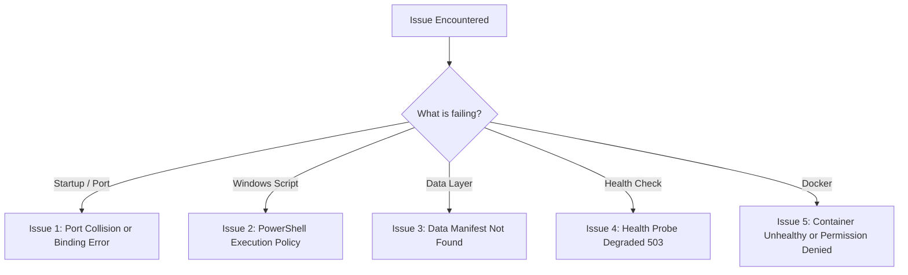

# Troubleshooting & Operational Incident Guide

**System**: Transaction Fraud Detection Analytics Platform & Power BI Simulation  
**Document**: Diagnostic Handbook — Failure Scenarios, Root Causes & Remediation  
**Audience**: Site Reliability Engineers, Developers, and Support Engineers  

---

## 1. Quick Diagnostic Flowchart



---

## 2. Common Operational Failure Scenarios

### Issue 1: PowerShell Script Execution Policy Error (`npm.ps1 cannot be loaded`)
- **Symptoms**: Running `npm install` or `npm run dev` in PowerShell fails with:
  ```
  npm : File C:\Program Files\nodejs\npm.ps1 cannot be loaded because running scripts is disabled on this system.
  ```
- **Root Cause**: Windows PowerShell execution policy restricts running unsigned `.ps1` wrapper scripts.
- **Resolution**:
  Use `npm.cmd` directly instead of `npm`:
  ```powershell
  cd app
  npm.cmd install
  npm.cmd run dev
  ```
  Or temporarily bypass execution policy for the current shell session:
  ```powershell
  Set-ExecutionPolicy -Scope Process -ExecutionPolicy Bypass
  ```

---

### Issue 2: Network Port Already Bound (`WinError 10048` / `EADDRINUSE`)
- **Symptoms**: Starting `python scripts/server.py` or `npm.cmd run dev` fails with:
  ```
  OSError: [WinError 10048] Only one usage of each socket address is normally permitted
  ```
- **Root Cause**: A previous background node or python process is still bound to port `4173`.
- **Resolution**:
  1. Identify and terminate the occupying process on port 4173:
     ```powershell
     # Find PID on port 4173
     Get-NetTCPConnection -LocalPort 4173 -ErrorAction SilentlyContinue | Select-Object OwningProcess
     # Stop process by PID
     Stop-Process -Id <PID> -Force
     ```
  2. Alternatively, set a different port in `.env`:
     ```ini
     APP_PORT=4180
     ```
     And start the server: `python scripts/server.py --port 4180`.

---

### Issue 3: "The evidence could not be assembled" (Missing `manifest.json`)
- **Symptoms**: Browser displays a red error screen: `The static data package did not load.`
- **Root Cause**: The static web data store has not been generated from the canonical CSV tables.
- **Resolution**:
  Regenerate the static JSON evidence store from the workspace root:
  ```powershell
  python analytics/build_dataset.py
  python analytics/build_phase2_data.py
  ```
  Reload the browser tab or click "Retry loading".

---

### Issue 4: Data Readiness Probe Returns `503 Service Unavailable`
- **Symptoms**: Polling `http://127.0.0.1:4173/health/data` returns HTTP 503 with `"status": "degraded"`.
- **Root Cause**: Less than 40 CSV tables exist in `tables/`, or one or more tables contain 0 bytes.
- **Resolution**:
  1. Run the local health check to identify the degraded table:
     ```powershell
     python scripts/health_check.py --type data
     ```
  2. If tables are missing or empty, restore the canonical tables from the latest verified backup:
     ```powershell
     python scripts/backup_manager.py --action restore --archive backups/backup_20261021_180458_phase7_baseline.zip --force
     ```

---

### Issue 5: Docker Container Marked Unhealthy
- **Symptoms**: `docker compose ps` shows `fraud-analytics-console (unhealthy)`.
- **Root Cause**: The internal healthcheck probe failed to contact `127.0.0.1:4173` within 5 seconds, or persistent volume mounts have incorrect permissions.
- **Resolution**:
  1. Inspect container logs:
     ```bash
     docker compose logs -f fraud-console
     ```
  2. Verify that `scripts/server.py` started successfully and bound to `0.0.0.0` (not `127.0.0.1` inside the container).
  3. Ensure persistent host directories (`logs/`, `backups/`) have write permissions for UID `10001` (`appuser`).

---

### Issue 6: Windows File Lock Error During Backup / Restore (`[WinError 32]`)
- **Symptoms**: A restore or cleanup operation fails with:
  ```
  [WinError 32] The process cannot access the file because it is being used by another process
  ```
- **Root Cause**: Windows indexing service, antivirus scanner, or an open application (e.g. Excel opening a CSV table) has locked the file.
- **Resolution**:
  1. Close any open spreadsheet viewers (Excel, LibreOffice) editing files in `tables/` or `backups/`.
  2. Re-run the command; `backup_manager.py` and `test_backup_recovery.py` include automatic retry and delay handlers.
