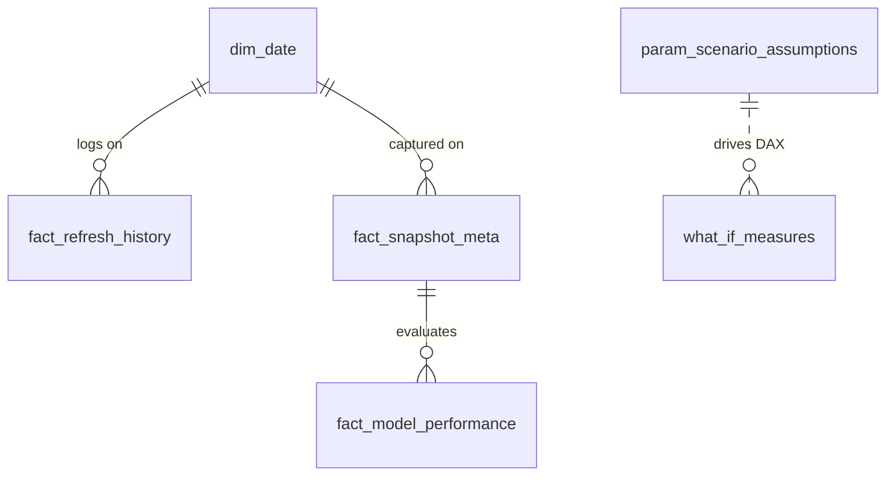

# Phase 6: Power BI Interoperability, Data Refresh & Scenario Modeling Guide

**Target Environment:** Power BI Desktop / Power BI Service  
**Data Interchange Directory:** `powerbi/data/`  
**Semantic Model Extension:** Phase 6 Intelligence Tables (`fact_refresh_history`, `fact_snapshot_meta`, `fact_scenario_assumptions`)  
**Verification Date:** October 2026

---

## 1. Executive Overview

Phase 6 provides native Power BI interoperability for the platform's data intelligence, snapshot versioning, and scenario simulation capabilities. 

To prevent modeling ambiguities and double-counting:
1. **Separation of Hypothetical Scenarios:** Scenario assumption tables are modeled as disconnected parameter tables rather than fact tables directly joined to historical transaction observations.
2. **Audit & Telemetry Logging:** Refresh history and snapshot records provide executive stakeholders with verified audit trails of analytical freshness directly inside Power BI reports.



---

## 2. Phase 6 Export Table Schemas

### Table 1: `fact_refresh_history.csv`
Contains the execution history of automated refresh runs.
- **Path:** `powerbi/data/fact_refresh_history.csv`
- **Columns:**
  - `refresh_id` (Text, Primary Key): e.g., `ref_1792601785`
  - `timestamp` (DateTime, ISO 8601): e.g., `2026-10-21T16:56:25Z`
  - `status` (Text): `SUCCESS` or `FAILED`
  - `duration_sec` (Decimal): Duration in seconds, e.g., `1.61`
  - `new_files` (Integer): Count of newly discovered source artifacts
  - `modified_files` (Integer): Count of modified artifacts detected via SHA-256
  - `failed_checks` (Integer): Count of failed pre-flight contract assertions

### Table 2: `fact_snapshot_meta.csv`
Catalog of immutable analytical checkpoints.
- **Path:** `powerbi/data/fact_snapshot_meta.csv`
- **Columns:**
  - `snapshot_id` (Text, Primary Key): e.g., `snap_20261021_v3_phase6`
  - `label` (Text): e.g., `Phase 6 Production Release`
  - `trigger` (Text): `release`, `refresh`, or `baseline`
  - `created_at` (DateTime, ISO 8601)
  - `source_fingerprint` (Text): Master 16-character SHA-256 prefix
  - `transactions` (Integer): Total records evaluated (1,852,394)
  - `optimized_pr_auc` (Decimal): Canonical PR-AUC score (0.9124)
  - `catch_at_1pct` (Decimal): Catch@1% capacity recall (0.8432)

### Table 3: `fact_scenario_assumptions.csv`
Baseline parameters and valid operating bounds for What-If modeling.
- **Path:** `powerbi/data/fact_scenario_assumptions.csv`
- **Columns:**
  - `scenario_id` (Text, Primary Key): e.g., `SCEN-01`
  - `scenario_type` (Text): `Review Capacity`, `Review Economics`, `Decision Threshold`, `Workload Scaling`
  - `parameter_name` (Text): Parameter identifier
  - `baseline_value` (Decimal): Canonical observed baseline value
  - `min_range` (Decimal): Minimum slider range boundary
  - `max_range` (Decimal): Maximum slider range boundary
  - `unit` (Text): Operational unit of measurement

---

## 3. Recommended DAX Measures

### Refresh & Pipeline Telemetry

```dax
Total Refresh Jobs = COUNTROWS('fact_refresh_history')

Successful Refreshes = 
CALCULATE(
    COUNTROWS('fact_refresh_history'),
    'fact_refresh_history'[status] = "SUCCESS"
)

Pipeline Reliability Rate = 
DIVIDE([Successful Refreshes], [Total Refresh Jobs], 1.0)

Avg Refresh Duration = 
AVERAGE('fact_refresh_history'[duration_sec])
```

### Snapshot Progression & Delta

```dax
Latest Production PR-AUC = 
CALCULATE(
    MAX('fact_snapshot_meta'[optimized_pr_auc]),
    'fact_snapshot_meta'[snapshot_id] = "snap_20261021_v3_phase6"
)

Baseline PR-AUC = 
CALCULATE(
    MAX('fact_snapshot_meta'[optimized_pr_auc]),
    'fact_snapshot_meta'[snapshot_id] = "snap_20261020_v1_baseline"
)

PR-AUC Improvement Delta = 
[Latest Production PR-AUC] - [Baseline PR-AUC]
```

### What-If Simulation Economics in Power BI

Using Power BI What-If parameter slicers:

```dax
// Parameter slicer: 'Capacity %'[Capacity % Value] from 0.1 to 5.0
// Parameter slicer: 'Hourly Wage'[Hourly Wage Value] from 15 to 75

Simulated Cases Reviewed = 
ROUNDUP(1852394 * ('Capacity %'[Capacity % Value] / 100), 0)

Simulated Investigator Labor Cost = 
[Simulated Cases Reviewed] * (6.0 / 60) * 'Hourly Wage'[Hourly Wage Value]

// Piecewise linear interpolation for fraud USD capture
Simulated Fraud Captured USD = 
VAR Cap = 'Capacity %'[Capacity % Value]
VAR RecallPct = 
    SWITCH(
        TRUE(),
        Cap <= 0.1, 0.4210,
        Cap <= 0.5, 0.4210 + (Cap - 0.1) / (0.5 - 0.1) * (0.7320 - 0.4210),
        Cap <= 1.0, 0.7320 + (Cap - 0.5) / (1.0 - 0.5) * (0.8432 - 0.7320),
        Cap <= 2.0, 0.8432 + (Cap - 1.0) / (2.0 - 1.0) * (0.9015 - 0.8432),
        Cap <= 5.0, 0.9015 + (Cap - 2.0) / (5.0 - 2.0) * (0.9510 - 0.9015),
        0.9510
    )
RETURN
    9651 * 124.50 * RecallPct

Simulated Net Financial Savings = 
[Simulated Fraud Captured USD] - [Simulated Investigator Labor Cost]
```

---

## 4. Step-by-Step Power BI Desktop Import Runbook

1. Launch **Power BI Desktop**.
2. Click **Get Data** $\to$ **Text/CSV**.
3. Navigate to `<repository_root>/powerbi/data/`.
4. Select `fact_refresh_history.csv`, click **Transform Data**.
   - Verify `timestamp` is typed as `Date/Time/Timezone`.
   - Verify `duration_sec` is typed as `Decimal Number`.
5. Select **New Source** $\to$ **Text/CSV** and load `fact_snapshot_meta.csv` and `fact_scenario_assumptions.csv`.
6. Click **Close & Apply**.
7. In the **Model View**, set `fact_scenario_assumptions` as an independent disconnected table (no active relationships to fact tables).
8. Create a new report page titled **"Phase 6: Data Intelligence & Scenarios"**.
9. Add a card visual for `[Latest Production PR-AUC]` and `[Pipeline Reliability Rate]`.
10. Add a line chart plotting `[Simulated Fraud Captured USD]` and `[Simulated Investigator Labor Cost]` against `'Capacity %'[Capacity % Value]`.
