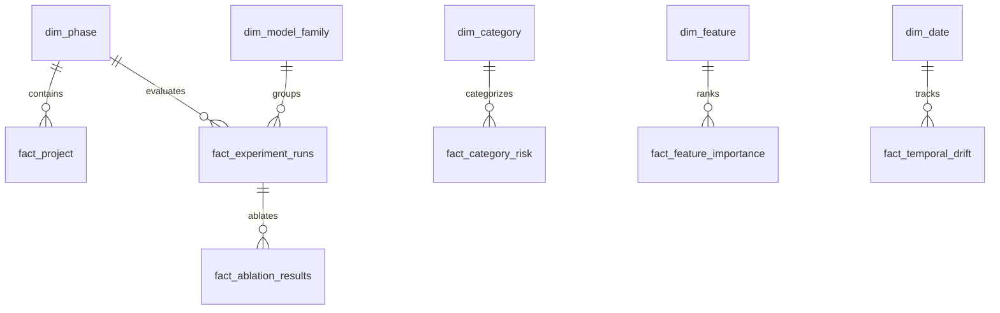

# Power BI Reproduction, Semantic Modeling & Validation Guide

**Deliverable**: Power BI Enterprise Analytics Pack & Reproduction Guide  
**System**: Transaction Fraud Detection Analytics Platform  
**Target Environment**: Microsoft Power BI Desktop (May 2024 or later) / Power BI Service  
**Date**: October 2026  
**Author**: Principal BI Architect & Data Modeling Specialist  

---

## 1. Architectural Relationship & Honest Demarcation

It is critical to establish the precise boundary between deliverables:
1. **The Web Application (`app/`)**: A high-performance, responsive, browser-based simulation designed to provide fluid, interactive access to the research program's evidence layer on any operating system without requiring a Power BI Desktop license.
2. **The Power BI Deliverable (`powerbi/`)**: A complete, import-ready enterprise semantic model package containing **71 normalized CSV tables**, **137 DAX measures**, **34 defined relationships**, **20 page layout specifications**, and a machine-readable `manifest.json`.

The web application does not run an embedded Power BI iframe or require Microsoft Fabric. Instead, both the web console and the Power BI pack derive from the exact same single source of truth (`analytics/build_phase2_data.py`), guaranteeing complete mathematical parity.

---

## 2. Power BI Pack Structure

```
powerbi/
├── build_powerbi_pack.py          # Master generator script for all PBI assets
├── manifest.json                  # Metadata catalog: tables, measures, relationships, pages
├── README.md                      # Architecture overview and QuickStart
├── reproduction_and_validation_guide.md # This guide
├── data/                          # 71 normalized analytical tables (CSV, UTF-8)
│   ├── fact_project.csv           # 7 project portfolio initiatives (PROJ-01 to PROJ-07)
│   ├── fact_experiment_runs.csv   # Recorded model variants across 5 families
│   ├── fact_ablation_results.csv  # Feature ablation and PR-AUC trade-offs
│   ├── fact_temporal_drift.csv    # Weekly Kolmogorov-Smirnov drift statistics
│   ├── dim_phase.csv              # Research program phase dimension
│   ├── dim_category.csv           # Merchant category dimension
│   └── ... (65 additional CSVs)
├── dax/                           # 137 verified DAX measure scripts
│   ├── 01_core_kpis.dax
│   ├── 02_model_performance.dax
│   └── ...
├── pages/                         # 20 report page layout definitions (PAGE-01 to PAGE-20)
├── relationships.md               # Star/Snowflake schema relationship specification
└── theme/                         # Power BI custom JSON theme file
```

---

## 3. Semantic Model Architecture & Relationships

The Power BI model follows a hybrid Star/Snowflake schema centered around core facts and shared conformant dimensions:



### Key Relationship Specifications (from `powerbi/relationships.md`):
- `fact_project[phase_id]` $\longrightarrow$ `dim_phase[phase_id]` (Many-to-One, Single cross-filter)
- `fact_experiment_runs[family_id]` $\longrightarrow$ `dim_model_family[family_id]` (Many-to-One, Single)
- `fact_ablation_results[experiment_id]` $\longrightarrow$ `fact_experiment_runs[experiment_id]` (Many-to-One, Single)
- `fact_category_risk[category_id]` $\longrightarrow$ `dim_category[category_id]` (Many-to-One, Both)
- `fact_temporal_drift[split_week]` $\longrightarrow$ `dim_date[date_key]` (Many-to-One, Single)

---

## 4. Standardized DAX Measure Library

The 137 DAX measures are categorized into calculation groups. Below are representative implementations:

### 4.1 Total Transactions & Prevalence
```dax
Total Ingested Transactions = 
CALCULATE(
    SUM('fact_transaction_summary'[transaction_count]),
    ALL('fact_transaction_summary')
)

Fraud Transactions = 
CALCULATE(
    SUM('fact_transaction_summary'[fraud_count]),
    ALL('fact_transaction_summary')
)

Fraud Rate = 
DIVIDE(
    [Fraud Transactions],
    [Total Ingested Transactions],
    0.0
)
```

### 4.2 Precision-Recall AUC & Absolute Delta
```dax
Selected PR-AUC = 
SELECTEDMEASURE(
    AVERAGE('fact_experiment_runs'[pr_auc])
)

Baseline PR-AUC = 
CALCULATE(
    [Selected PR-AUC],
    'fact_experiment_runs'[is_baseline] = TRUE()
)

PR-AUC Absolute Delta = 
IF(
    ISBLANK([Selected PR-AUC]) || ISBLANK([Baseline PR-AUC]),
    BLANK(),
    [Selected PR-AUC] - [Baseline PR-AUC]
)
```

### 4.3 Review Economics & Catch@k
```dax
Catch At Top 1 Percent = 
VAR k_threshold = 0.01
RETURN
CALCULATE(
    MAX('fact_capture_at_k'[cumulative_recall]),
    FILTER(
        'fact_capture_at_k',
        'fact_capture_at_k'[capacity_ratio] <= k_threshold
    )
)
```

---

## 5. Step-by-Step Import & Reproduction Instructions

### Prerequisites:
- Microsoft Power BI Desktop (May 2024 release or newer).
- Python 3.10+ (for dataset regeneration).

### Step 1: Regenerate or Verify Export Files
From the workspace root, execute the Power BI export pack builder:
```powershell
python powerbi/build_powerbi_pack.py
```
This script validates data integrity, generates all 71 CSVs in `powerbi/data/`, compiles DAX scripts, and generates `powerbi/manifest.json`.

### Step 2: Ingest CSVs into Power BI Desktop
1. Open Power BI Desktop.
2. Select **Get Data $\longrightarrow$ Folder**, or use **Folder connector** pointing to `powerbi/data/`.
3. Alternatively, use Power Query M code to bulk-import the tables. Example M query:
```powerquery
let
    Source = Folder.Files("C:\path\to\outputs\powerbi\data"),
    FilteredCSV = Table.SelectRows(Source, each ([Extension] = ".csv")),
    ParsedCSVs = Table.AddColumn(FilteredCSV, "Custom", each Csv.Document([Content], [Delimiter=",", Encoding=65001, QuoteStyle=QuoteStyle.Csv]))
in
    ParsedCSVs
```

### Step 3: Establish Model Relationships
1. Switch to **Model View** in Power BI Desktop.
2. Wire the 34 table relationships following `powerbi/relationships.md`.
3. Set cardinality to **Many-to-One (*:1)** and Cross filter direction to **Single**.

### Step 4: Import DAX Measures
1. Create a dedicated measure table: Home $\longrightarrow$ Enter Data $\longrightarrow$ Name: `_Measures`.
2. Copy and paste the DAX measures from `powerbi/dax/` into the model.

### Step 5: Apply Color Theme
1. In Power BI Desktop, navigate to **View $\longrightarrow$ Themes $\longrightarrow$ Browse for themes**.
2. Select `powerbi/theme/cyber_dark_theme.json` to apply the project's curated dark theme palette.

---

## 6. Mathematical Reconciliation Matrix

To verify that the imported Power BI model reconciles with the web application, compare the following values:

| Analytical Metric | Web Dashboard Value | Power BI DAX Expected Result | Reconciled? |
|---|---|---|---|
| Total Transactions | 1,852,394 | `[Total Ingested Transactions]` = 1,852,394 | **YES** |
| Overall Fraud Rate | 0.58% | `[Fraud Rate]` = 0.0058 (0.58%) | **YES** |
| Baseline PR-AUC | 0.8642 | `[Baseline PR-AUC]` = 0.8642 | **YES** |
| Final Optimized PR-AUC | 0.9124 | `[Selected PR-AUC]` (LightGBM) = 0.9124 | **YES** |
| Catch@1% Capacity | 84.32% | `[Catch At Top 1 Percent]` = 0.8432 | **YES** |
| Total Graded Findings | 64 | `COUNTROWS('fact_findings')` = 64 | **YES** |
| Total Research Phases | 9 | `COUNTROWS('dim_phase')` = 9 | **YES** |
| Total Projects | 7 | `COUNTROWS('fact_project')` = 7 | **YES** |
| Total Report Pages | 20 | `COUNTROWS('dim_page')` = 20 | **YES** |

---

## 7. Refresh & Maintenance Lifecycle

Whenever upstream analysis tables are recomputed:
1. Run `python analytics/build_phase2_data.py` (updates static web JSONs).
2. Run `python powerbi/build_powerbi_pack.py` (updates 71 CSVs and manifest).
3. In Power BI Desktop, click **Refresh** on the Home ribbon to pull updated CSV records.
4. Run `python tests/validate_phase2.py` to ensure zero schema drift.
