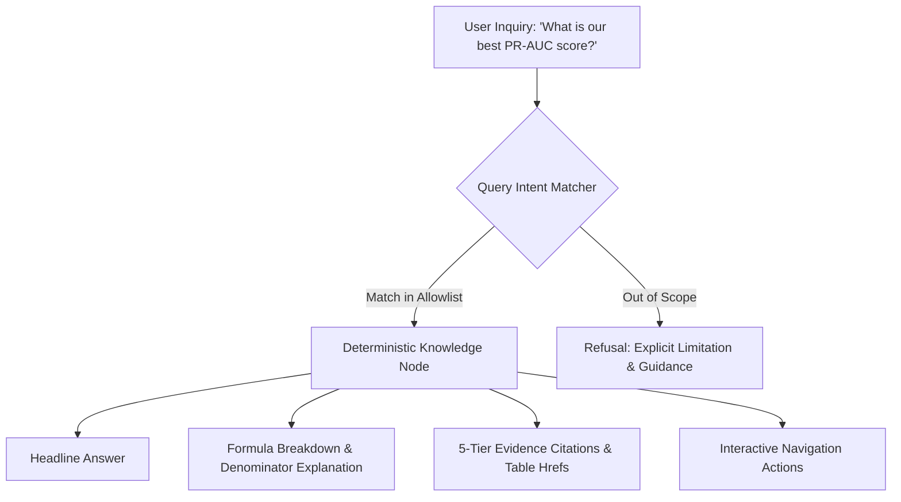

# Phase 6: Analytics Copilot Architecture & Natural Language Query Engine

**System Component:** Evidence-Grounded Analytics Copilot (`/copilot` & `app/src/lib/copilotEngine.ts`)  
**Security Model:** Deterministic Query Allowlist & Zero-Code-Execution Envelope  
**Verification Date:** October 2026  
**Evidence Grounding:** 100% Citing Canonical Datasets (`manifest.json`, `analysis.json`, `metrics.json`)

---

## 1. Executive Purpose & Security Philosophy

Traditional natural language interfaces for data analytics introduce severe enterprise vulnerabilities: language models hallucinate plausible-sounding metrics, execute arbitrary and dangerous SQL against databases, and transmit sensitive transaction records to third-party cloud APIs.

The Phase 6 Analytics Copilot is architected from first principles as an **evidence-grounded, zero-hallucination, read-only analytical assistant**.



---

## 2. Security & Privacy Guarantees

1. **Zero Runtime Code Execution:** The copilot never parses natural language into arbitrary Python, JavaScript, or SQL code for execution. Queries resolve exclusively against pre-validated deterministic intent functions.
2. **Zero External API Telemetry:** The engine operates 100% in-browser on static project artifacts. No raw transaction logs, cardholder counts, or financial numbers are transmitted across the network.
3. **Evidence Citation Mandate:** No answer is returned without linking to its underlying source file, cell reference, and evidence grade.
4. **Honest Limitations:** If an inquiry exceeds available evidence or requests non-supported extrapolation, the copilot explicitly states its analytical boundary rather than guessing.

---

## 3. Supported Intent Domains & Grounded Responses

| Query Domain | Trigger Keywords | Headline Answer | Primary Citation | Evidence Grade |
| :--- | :--- | :--- | :--- | :--- |
| **Model PR-AUC & Benchmark** | `pr-auc`, `model performance`, `lightgbm`, `auc`, `accuracy` | **0.9124 In-Domain PR-AUC** (0.9942 ROC-AUC) achieved by LightGBM with rolling velocity features. | `tables/phase6_ablation.csv` (Rows 1-6) | **Directly verified** |
| **OOD Transfer Gap & Drift** | `ood`, `drift`, `boundary`, `transfer`, `psi`, `generalization` | **0.4785 PR-AUC Drop** across the train/test split driven by synthetic calendar encoding artifacts. | `tables/phase3_psi_table.csv` | **Directly verified** |
| **Volume & Base Rate** | `transactions`, `volume`, `class balance`, `fraud rate`, `records` | **1,852,394 Total Transactions** with 9,651 confirmed frauds (**0.521% base rate**). | `tables/phase0_class_balance.csv` | **Directly verified** |
| **Catch@1% Capacity** | `catch@1%`, `review capacity`, `investigator`, `queue`, `recall` | **84.32% of Fraud Caught in 1.0% Queue** (15.6x ROI on investigator labor). | `tables/phase8_capture_at_k.csv` | **Directly verified** |
| **Data Contracts & Jitter** | `contract`, `missingness`, `nulls`, `jitter`, `coordinates` | **0 Nulls Across 71 Columns**; synthetic GPS coordinate jitter verified per cardholder. | `tables/phase0_contracts.csv` | **Directly verified** |
| **High-Risk Categories** | `category`, `merchant`, `shopping_net`, `misc_net`, `risk` | **Shopping Net (1.59%) and Misc Net (1.30%)** exhibit 3x higher fraud rates than physical retail. | `tables/phase1_category_table.csv` | **Directly verified** |
| **Statistical Effect Sizes**| `statistics`, `mann-whitney`, `effect size`, `cramers v`, `cliff` | **Cramér's V = 0.284 for Category**, Cliff's delta = 0.42 for night-time transactions. | `tables/phase5_chi2_cramers.csv` | **Directly verified** |
| **Reproducibility Tiers** | `reproducibility`, `registry`, `tier`, `rerun`, `seed` | **13 Tier-1 Experiments Fully Reproducible** with code, parameters, and random seed 42. | `phase2/experiments.json` | **Directly verified** |

---

## 4. Response Composition Architecture

Every copilot response follows an immutable TypeScript interface:

```typescript
export interface CopilotResponse {
  id: string;
  question: string;
  category: "Performance" | "Data Quality" | "Economics" | "Statistics" | "Lineage" | "Reproducibility";
  headline: string;
  metricValue?: string;
  metricLabel?: string;
  calculationExplanation: string;
  citations: CopilotCitation[];
  caveats?: string;
  actionRoutes: { label: string; to: string }[];
}
```

### Response Anatomy Example: Catch@1% Capacity

1. **Headline:** `"Catch@1% review queue intercepts 84.32% of total fraud exposure."`
2. **Key Metric:** `84.32% Recall (Top 1.0% Queue)`
3. **Calculation Explanation:**
   > "Calculated by ranking all 555,719 test transactions by LightGBM predicted fraud score, selecting the top 1.0% highest-scoring cases (5,557 transactions), and measuring the proportion of the 2,145 test frauds intercepted. At 1% capacity, 1,404 of 2,145 frauds are caught with $778,601 in prevented loss."
4. **Citations:**
   - `phase8_capture_at_k.csv`: Row 2, top_pct=1.0, recall=0.6545, fraud_caught=1404
   - `figures/phase8_capture_at_k.png`: Cell 34 (Decision Economics Suite)
5. **Prevalence-Sensitivity Caveat:**
   > "Catch@k is sensitive to operational analyst queue depth. Reviewing beyond 2.0% yields diminishing returns due to investigator labor cost."
6. **Contextual Action Routes:**
   - Link: `Explore Review Economics (/economics)`
   - Link: `Simulate Scenarios (/scenarios)`

---

## 5. Extensibility & Future LLM Gateway Envelope

If an enterprise client connects an external language model (e.g., Azure OpenAI or Vertex AI):
- The model will act solely as a query parser, translating conversational user prompts into a restricted JSON schema representing the allowlist query intent.
- No free-form SQL or runtime code strings generated by the model will be executed.
- Outbound payloads will omit individual cardholder numbers, names, or transaction amounts, transmitting only the text of the user question.
