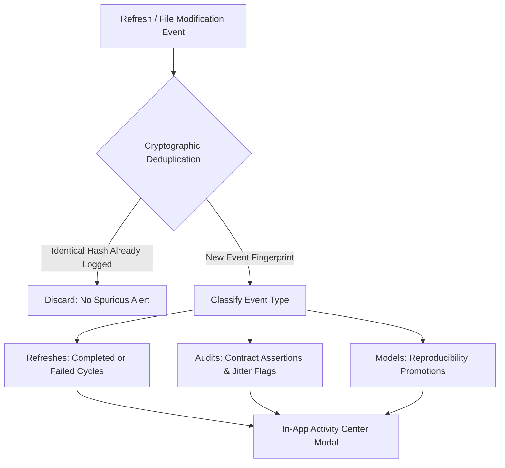

# Phase 6: Safe Data Change Detection & Activity Intelligence

**System Component:** In-App Activity Center & Change Intelligence (`ActivityCenterModal.tsx` & `analytics/refresh_engine.py`)  
**Notification Medium:** Localized In-App Activity Center (Zero Unsolicited External Alerts)  
**Verification Date:** October 2026  
**Noise Control:** Cryptographic Deduplication & Event Fingerprinting

---

## 1. Executive Purpose & Notification Governance

In analytical operations, unmanaged notification systems rapidly become alert fatigue hazards: repeated alerts fire for known static states, or minor decimal jitter in background metrics triggers spurious warnings.

The Phase 6 Change Intelligence mechanism is designed with strict noise reduction rules:
1. **Zero External Spam:** The platform operates strictly with an in-app activity center. No external email, SMS, or webhook spam is emitted without explicit configuration.
2. **Cryptographic Deduplication:** Repeated pipeline executions on unchanged files do not generate duplicate notification items.
3. **Actionable Deep-Links:** Every alert includes an explicit explanation of *why it matters* and a direct navigation button to investigate the root cause.

---

## 2. Monitored Event Taxonomy

| Event Category | Trigger Condition | Severity | Example In-App Notification | Deep-Link Destination |
| :--- | :--- | :--- | :--- | :--- |
| **Pipeline Failure** | Data contract assertion failed during Stage 3 | `CRITICAL` | `Stage 3 Contract Breach: 4 nulls detected in phase0_schema.csv. Refresh aborted.` | `/refresh` |
| **Pipeline Success** | Full 6-stage refresh cycle completed | `SUCCESS` | `Refresh Succeeded: 185 sources scanned in 1.61s. All 4 contracts verified.` | `/refresh` |
| **Snapshot Created** | New historical snapshot stamped | `INFO` | `New Snapshot Captured: 'Phase 6 Production Release' (PR-AUC: 0.9124).` | `/snapshots` |
| **Reproducibility Promotion** | Experiment promoted to Tier 1 | `SUCCESS` | `Experiment Registry Updated: 13 runs classified as Tier-1 Reproducible.` | `/experiments` |
| **Generator Warning** | Known synthetic artifact flagged in source | `WARN` | `Forensic Jitter Active: Merchant coordinates fluctuate per transaction.` | `/data-audit` |

---

## 3. Deduplication Algorithm

To prevent alert storms during rapid iterative development, the engine generates an event fingerprint:

$$\text{Event Fingerprint} = \text{SHA256}\left(\text{Category} + \text{Trigger} + \text{TargetFile} + \text{ObservedChecksum}\right)$$

If an incoming notification matches an existing event fingerprint in `localStorage` or `refresh_history.json`, its count is incremented rather than creating a new card.

---

## 4. Activity Center UI Implementation

The Activity Center modal is accessible via the topbar bell icon:
- **Unread Badge:** An indigo pulse dot signals unread operational events.
- **Filtering Rail:** Tabs allow instant filtering across `All Events`, `Refreshes`, and `Audits`.
- **Management Controls:** Users can dismiss individual notifications, click `Mark read`, or `Clear all`.
- **Investigation Links:** Clicking any notification routes directly to the relevant dashboard page (e.g., clicking a contract alert opens `/data-audit`).
