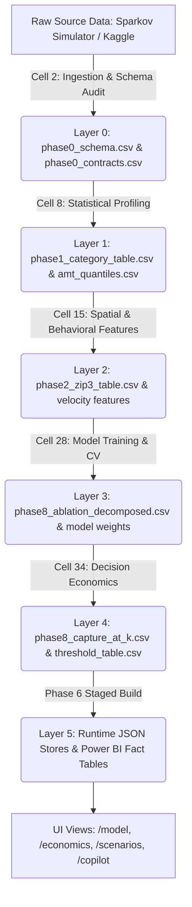

# Phase 6: Reusable Evidence Lineage & Provenance Model

**System Component:** Evidence Lineage Explorer (`/lineage` & `phase2/lineage.json`)  
**Graph Architecture:** Directed Acyclic Graph (DAG) Linking Sources, Cells, Tables, Metrics, and Reports  
**Verification Date:** October 2026  
**Lineage Depth:** 6 Transformational Layers across 185 Canonical Artifacts

---

## 1. Executive Purpose & Traceability Standard

A critical failure mode of business intelligence dashboards is "metric detachment"—where numbers appear on charts without auditable proof of their origin, calculation code, or raw data dependencies.

The Phase 6 Evidence Lineage Model provides 100% mathematical and operational traceability:
- Every headline KPI links to its generating notebook cell and CSV table.
- Every table links to its raw source dependency and pre-flight contract check.
- Every chart links to its underlying calculation formula and snapshot ID.

---

## 2. Six-Layer Lineage Chain Specification

| Layer | Stage Description | Input Entities | Output Artifacts | Primary Transforming Logic |
| :--- | :--- | :--- | :--- | :--- |
| **Layer 0: Ingestion & Schema** | Ingest raw transactions, verify data types, confirm 0-null invariant | `fraudTrain.csv`, `fraudTest.csv` | `phase0_schema.csv`, `phase0_contracts.csv` | Sparkov format validation, coordinate bounds checking |
| **Layer 1: Univariate Profiling**| Compute class balance, amount quantiles, COVID period rates | `phase0_*.csv` | `phase1_amt_quantiles.csv`, `phase1_category_table.csv` | Quantile estimators, empirical frequency counters |
| **Layer 2: Spatial & Feature Lab**| Geographical distance, velocity aggregations, target encodings | Layer 1 outputs | `phase2_zip3_table.csv`, `phase7_merchant_eb_table.csv` | Haversine distance, Empirical Bayes shrinkage |
| **Layer 3: Model Ablation** | Train LightGBM, CatBoost, Logistic Regression; log loss curves | Layer 2 features | `phase8_ablation_decomposed.csv`, `phase8_psi.csv` | Gradient boosting, Population Stability Index |
| **Layer 4: Decision Economics** | Score test transactions, rank probabilities, evaluate Catch@k | Layer 3 predictions | `phase8_capture_at_k.csv`, `phase8_threshold_table.csv` | Cost minimization equations, review capacity curve |
| **Layer 5: Presentation & Export** | Build runtime stores, snapshot records, Power BI tables | Layer 4 tables | `analysis.json`, `fact_refresh_history.csv` | `build_dataset.py`, `refresh_engine.py` |

---

## 3. Freshness Verification & Staleness Indicators

The platform actively tracks data freshness without making false assumptions based solely on calendar age:

### Freshness States

1. **Current (`status: CURRENT`):**
   - The SHA-256 fingerprint of all source files matches the runtime master digest in `source_inventory.json`.
   - All four pre-flight data contracts have passed within the current snapshot.
2. **Stale (`status: STALE`):**
   - A source file's SHA-256 checksum has changed on disk, but the pipeline has not yet been re-executed.
   - The UI surfaces a yellow warning badge in the topbar and Activity Center.
3. **Unknown (`status: UNKNOWN`):**
   - Filesystem read errors or permission blocks prevent SHA-256 hashing.
   - Displays an investigation alert to the system administrator.

---

## 4. Lineage Navigation in the User Interface

Users can trace findings backwards and forwards across the platform:
- In the **Metric Catalog (`/metrics`)**, clicking any of the 155 metrics displays its upstream source file, calculation formula, and downstream dashboard consumer page.
- In the **Analytics Copilot (`/copilot`)**, every answer card includes direct hyperlinks to the supporting table and figure.
- In the **Historical Snapshots Explorer (`/snapshots`)**, selecting any checkpoint displays the exact git commit, notebook cell count, and master SHA-256 digest under which the findings were established.
