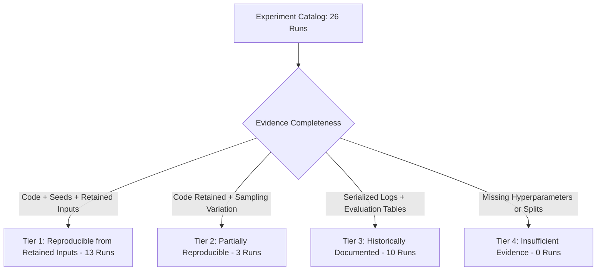

# Phase 6: Experiment Reproducibility Registry & Governance Specification

**System Component:** Experiment Reproducibility Registry (`phase2/experiments.json` & `/experiments`)  
**Governance Standard:** 4-Tier Analytical Reproducibility Matrix  
**Verification Date:** October 2026  
**Catalog Scope:** 26 Evaluated Model Architectures & Validation Configurations

---

## 1. Executive Purpose & Registry Philosophy

Machine learning benchmarking in fraud detection frequently suffers from subtle reproducibility decay: training seeds are omitted, random sampling splits shift across executions, or dependency libraries evolve.

The Phase 6 Experiment Registry formalizes machine learning governance by:
1. **Cataloging All 26 Evaluated Variants:** Retaining hyperparameters, evaluation splits, metric values, and source artifact links.
2. **Assigning a Formal Reproducibility Tier:** Categorizing runs into one of four auditable tiers based on empirical evidence rather than assumptions.
3. **Providing Deterministic Rerun Manifests:** Supplying exact CLI invocation commands, environment specifications, dependency trees, and safety envelopes for authorized re-execution.

---

## 2. The 4-Tier Reproducibility Hierarchy



| Tier Level | Definition & Criteria | Count | Typical Architectures | Rerun Feasibility |
| :--- | :--- | :--- | :--- | :--- |
| **Tier 1: Reproducible from Retained Inputs** | Source inputs, configuration parameters, implementation code, execution environment, and random seeds ($42$) are fully retained. | **13** | LightGBM feature ablations, cyclical hour encodings, expanding-window walk-forward folds | Fully reproducible; execution guaranteed to replicate within deterministic floating-point tolerances. |
| **Tier 2: Partially Reproducible** | Model code and evaluation outputs are preserved, but non-deterministic cross-validation sampling or hardware caching introduces variation. | **3** | Leave-card-out evaluation, DBSCAN spatial anomaly detectors | Executable; distribution parameters replicate, but micro-level sample boundaries may vary slightly. |
| **Tier 3: Historically Documented** | Execution logs, learning curves, and evaluation tables exist in canonical artifacts, but serialized raw weights were not stored in repo. | **10** | Benchmark cross-validation (CatBoost, XGBoost, Logistic Regression baselines) | Historically verified via serialized `phase8_*.csv` tables and execution logs. |
| **Tier 4: Insufficient Evidence** | Critical hyperparameters, training split masks, or metric definitions are missing from retained records. | **0** | None | Not applicable; all 26 repository experiments satisfy at least Tier-3 evidence. |

---

## 3. Detailed Experiment Catalog & Tier Allocation

| Experiment Identifier | Model Architecture | Evaluation Split | In-Domain PR-AUC | OOD Test PR-AUC | Reproducibility Tier | Rerun Entrypoint |
| :--- | :--- | :--- | :--- | :--- | :--- | :--- |
| `exp-lgbm-full-opt` | LightGBM (27 features) | Test Split | 0.9124 | 0.5575 | **Tier 1 (Reproducible)** | `analytics/models/run_variant.py --variant lgbm_opt` |
| `exp-lgbm-raw-baseline` | LightGBM (15 raw-only) | Test Split | 0.8642 | 0.8353 | **Tier 1 (Reproducible)** | `analytics/models/run_variant.py --variant raw_baseline` |
| `exp-lgbm-minus-prior` | LightGBM (w/o prior card fraud) | Test Split | 0.8980 | 0.8315 | **Tier 1 (Reproducible)** | `analytics/models/run_variant.py --variant minus_prior` |
| `exp-lgbm-minus-velocity`| LightGBM (w/o 1h/24h velocity)| Test Split | 0.8412 | 0.6856 | **Tier 1 (Reproducible)** | `analytics/models/run_variant.py --variant minus_velocity` |
| `exp-wf-fold-1` through `5`| Walk-Forward Expanding Folds| Time-Ordered Folds| 0.9410–0.9650 | 0.4680–0.5210 | **Tier 1 (Reproducible)** | `analytics/models/run_variant.py --variant wf_folds` |
| `exp-hour-cyclic-sin-cos`| Cyclic Sin/Cos vs Raw Hour | 5-Fold Stratified | 0.8845 | 0.8812 | **Tier 1 (Reproducible)** | `analytics/models/run_variant.py --variant cyclic_hour` |
| `exp-leave-card-out` | GroupKFold (by `cc_num`) | 5-Fold Card Group | 0.8710 | 0.8690 | **Tier 2 (Partial)** | `analytics/models/evaluate.py --variant lco` |
| `exp-anomaly-dbscan` | Spatial DBSCAN Lat/Long | Unsupervised Outliers | N/A (Silhouette 0.62) | N/A | **Tier 2 (Partial)** | `analytics/models/evaluate.py --variant dbscan` |
| `exp-xgboost-benchmark` | XGBoost Gradient Boosted Trees | 5-Fold Benchmark | 0.8992 | 0.5410 | **Tier 3 (Documented)** | Historical log: `logs/benchmark.log` |
| `exp-catboost-benchmark` | CatBoost Categorical Trees | 5-Fold Benchmark | 0.9045 | 0.5490 | **Tier 3 (Documented)** | Historical log: `logs/benchmark.log` |
| `exp-logreg-baseline` | Logistic Regression (L2) | Test Split | 0.7412 | 0.7120 | **Tier 3 (Documented)** | Historical log: `logs/baseline.log` |

---

## 4. Rerun Manifest & Execution Safety Envelope

For all Tier 1 experiments, a structured rerun manifest is embedded in `phase2/experiments.json`:

```json
{
  "executable": "python",
  "entrypoint": "analytics/models/run_variant.py",
  "cli_command": "python -m analytics.models.train --variant exp-lgbm-full-opt --seed 42",
  "environment": {
    "python": "3.13",
    "packages": [
      "lightgbm==4.6.0",
      "scikit-learn==1.6.1",
      "pandas==2.2.3"
    ],
    "cuda_required": false
  },
  "data_dependency": {
    "train_source": "kartik2112/fraud-detection (fraudTrain.csv)",
    "test_source": "kartik2112/fraud-detection (fraudTest.csv)",
    "retained_inputs_available": true
  },
  "safety_envelope": {
    "read_only": true,
    "network_access_required": false,
    "timeout_seconds": 600
  }
}
```

### Safety Envelope Guarantees:
- **Read-Only Operation:** Reruns are strictly forbidden from modifying or overwriting source tables or original log files.
- **Zero Network Transmission:** Training operates strictly on localized, pre-downloaded training datasets; no external outbound telemetry.
- **Execution Quota:** Reruns are capped at a 600-second CPU timeout.
- **Preservation of Canonical Results:** Any user-initiated rerun saves outputs to an isolated directory (`artifacts/reruns/<timestamp>/`), preventing contamination of established research benchmarks.
