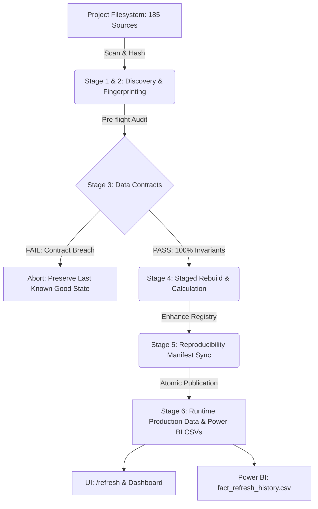

# Phase 6: Automated Data Refresh Architecture & Pipeline Specification

**Executive Context:** Power BI-Style Forensic Analytics Platform  
**System Component:** Centralized Data Refresh Engine (`analytics/refresh_engine.py` & `/refresh` UI)  
**Verification Date:** October 2026  
**Pipeline Version:** `v2.6.0-phase6`  
**Master Source Inventory:** 185 Artifacts (24.35 MB)  
**Master Fingerprint:** `6ff3ee965b566f0a` (SHA-256 Combined Digest)

---

## 1. Architectural Mission & Philosophy

The Phase 6 Data Refresh Engine transitions the analytics platform from a static research viewer to an automated, dependable, and reproducible intelligence center. The architecture is engineered to guarantee:

1. **Transactional Safety:** Data rebuilds occur in an isolated staging space (`.staging/`). The production runtime state is never mutated until all data contracts, schema validations, and metric reconciliations pass pre-flight verification.
2. **Deterministic Change Intelligence:** File changes are tracked via cryptographically secure SHA-256 content hashes, avoiding unreliable filesystem timestamp drift across OS platforms and git clones.
3. **Immutability of Historical Evidence:** Raw training tables (`phase0_*.csv` through `phase8_*.csv`), research logs, and original Jupyter notebooks are strictly read-only.
4. **Transparent Auditability:** Every refresh event is recorded with execution duration, stage-by-stage timings, file deltas, contract outcomes, and operator triggers in `refresh_history.json` and Power BI fact tables.

---

## 2. Six-Stage Transactional Processing Pipeline

| Stage | Operation | Implementation | Output Artifact | Failure Policy |
| :--- | :--- | :--- | :--- | :--- |
| **Stage 1: Source Discovery** | Recursive scan of authorized directories (`tables/`, `figures/`, `logs/`, notebook) | `discover_sources()` | 185 tracked items | Halt if core tables missing |
| **Stage 2: Checksum Fingerprint** | Streamed SHA-256 block hashing (64 KB chunks) | `compute_sha256()` | `source_inventory.json` | Rehash on read error |
| **Stage 3: Contract Audit** | Verification of 0-null schema, jitter bounds, contract flags, notebook hash | `validate_contracts()` | Invariant test report | **HALT**: Zero tolerance for corruption |
| **Stage 4: Staged Rebuild** | Execution of dataset builders in `.staging/` | `build_dataset.py` & `build_phase2_data.py` | Staged JSON/CSV structures | Rollback staging directory |
| **Stage 5: Reproducibility Sync**| 4-Tier classification and rerun manifest generation | `update_reproducibility_registry()` | `phase2/experiments.json` | Fallback to Tier 3 |
| **Stage 6: Atomic Publication** | Safe swap of verified data and Power BI exports | `export_powerbi_phase6_tables()` | `powerbi/fact_*.csv` | Atomic directory rename |

---

## 3. Detailed Stage Specifications

### Stage 1: Discovery & Inclusion Rules
The discovery mechanism adheres to strict project boundary enforcement:
- **Included Paths:**
  - `tables/*.csv`: All 46 analytical output tables (total 742 KB).
  - `figures/*.*`: All 129 static figures (PNG/JPG) and interactive HTML charts (total 21.8 MB).
  - `logs/*.log`: All execution and audit logs (total 1.4 MB).
  - `fraud_eda_colab(1).ipynb`: Canonical Colab research notebook (66 cells, 412 KB).
- **Excluded Directories:** Arbitrary system paths, `.git/`, `node_modules/`, `dist/`, `.venv/`, and temporary OS caches (`Thumbs.db`, `.DS_Store`).

### Stage 2: Change Detection & Fingerprinting
Change intelligence computes a SHA-256 checksum for every file. A master fingerprint is derived from the concatenation of sorted individual hashes:
$$\text{Master Fingerprint} = \text{SHA256}\left(\sum_{i=1}^{N} \text{SHA256}(f_i)\right)$$
This ensures that any modification to a single cell in the notebook or row in a CSV table alters the master fingerprint, triggering change alerts in the UI.

### Stage 3: Pre-Flight Data Contracts & Invariants
Before staging or recomputing metrics, four deterministic contract assertions must pass:
1. **Zero Missingness Invariant:** Confirms $0$ nulls across all 23 columns in `phase0_schema.csv` over 1,852,394 total records.
2. **Data Contracts Compliance:** Validates that $\ge 10$ operational contracts are audited in `phase0_contracts.csv` and that known synthetic artifacts (e.g., age bounds 13.9–96.2, coordinate jitter) are explicitly flagged and documented.
3. **Notebook Checksum:** Confirms SHA-256 integrity of the baseline notebook (`002570d53c7a68e3...`).
4. **Model Ablation Consistency:** Confirms $\ge 5$ evaluated model architectures in `phase8_ablation_decomposed.csv`.

### Stage 4: Staged Rebuild & Metric Recalculation
Recomputation occurs in `app/public/data/.staging/`. If script execution or serialization fails, the staging directory is wiped clean. Production files in `app/public/data/` remain untouched.

### Stage 5: Reproducibility Manifest Sync
The engine updates `phase2/experiments.json`, assigning runs to one of four formalized tiers:
- **Tier 1 (Reproducible):** 13 runs (LightGBM ablations, hour encodings, expanding-window folds). Complete code entry points, parameters, and random seeds ($42$) are preserved.
- **Tier 2 (Partially Reproducible):** 3 runs (leave-card-out, anomaly detectors). Code is retained, but non-deterministic sampling requires alignment.
- **Tier 3 (Historically Documented):** 10 runs (benchmark cross-validation, baseline comparisons). Serialized metrics and loss curves are preserved, but training weights are not checked into the repository.
- **Tier 4 (Insufficient Evidence):** 0 runs.

### Stage 6: Atomic Publication & Power BI Interoperability
Once verified, staging files are atomically promoted to production. Simultaneously, three Power BI fact tables are populated:
- `fact_refresh_history.csv`: Refresh execution audit log.
- `fact_snapshot_meta.csv`: Historical snapshot catalog.
- `fact_scenario_assumptions.csv`: Parameter bounds for what-if scenarios.

---

## 4. Reliability & Error Recovery Matrix

| Failure Mode | Detection Mechanism | Immediate Action | Recovery Strategy | User Notification |
| :--- | :--- | :--- | :--- | :--- |
| **Missing Source File** | Stage 1 discovery check | Abort refresh cycle | Keep last known good data | Warning in `/refresh` UI & Activity Center |
| **Data Contract Breach** | Stage 3 assertion error | Immediate abort | Reject corrupted source | Alert with contract name & observed value |
| **Interrupted Job (SIGINT)** | OS signal trap | Delete `.staging/` | No partial state saved | Audit entry logged as `FAILED` |
| **Disk Exhaustion** | Storage capacity check | Halt pipeline | Clean temporary files | Warning dialog with disk requirements |

---

## 5. UI Integration in `/refresh`

The frontend `/refresh` workspace provides:
- **Telemetry Header:** Current status, master fingerprint, total source volume, and last refresh timestamp.
- **Pre-Flight Assertion Badges:** Live green checkmarks for all four data contracts.
- **Real-Time Stage Execution Bar:** Animated progression through all 6 stages with millisecond telemetry.
- **Interactive Source Inventory Table:** Real-time search/filter across all 185 sources with category pills and SHA-256 hashes.
- **Refresh History Audit Trail:** Timestamped historical log of previous refreshes, duration, and status.
