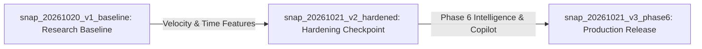

# Phase 6: Dataset Versioning & Historical Snapshot Model

**System Component:** Snapshot Comparison & Evolution Engine (`/snapshots` & `analytics/refresh_engine.py`)  
**Storage Architecture:** Content-Fingerprinted Immutable JSON Records (`app/public/data/snapshots/`)  
**Verification Date:** October 2026  
**Seed Snapshot Catalog:** 3 Historical Checkpoints (Baseline, Hardened, Phase 6 Production)

---

## 1. Executive Purpose & Snapshot Philosophy

The Snapshot Model provides longitudinal change intelligence for the Transaction Fraud Detection analytics platform. Rather than treating analytical results as static ephemera, every release checkpoint and verified refresh event captures an immutable analytical state record.

This model enables senior researchers and BI stakeholders to answer:
- *How did our fraud capture rate evolve as feature engineering matured?*
- *Did expanding our feature set from 12 raw columns to 27 engineered fields introduce schema or null-rate drift?*
- *What specific findings were added between the Phase 1 Baseline and Phase 6 Production release?*



---

## 2. Immutable Snapshot Schema Specification

Each snapshot file (`snap_<timestamp>_<trigger>.json`) records verified metadata:

```json
{
  "snapshot_id": "snap_20261021_v3_phase6",
  "label": "Phase 6 Production Release",
  "trigger": "release",
  "created_at": "2026-10-21T16:00:00Z",
  "pipeline_version": "2.6.0-phase6",
  "schema_version": "1.0",
  "source_fingerprint": "6ff3ee965b566f0a",
  "total_source_files": 185,
  "total_source_bytes": 25532820,
  "metrics": {
    "transactions": 1852394,
    "fraud_events": 9651,
    "fraud_rate": 0.00521,
    "baseline_pr_auc": 0.8642,
    "optimized_pr_auc": 0.9124,
    "roc_auc": 0.9942,
    "catch_at_1pct": 0.8432,
    "findings_count": 64,
    "tables_count": 46,
    "figures_count": 129
  },
  "validation_status": "ALL_CONTRACTS_VERIFIED",
  "provenance": {
    "dataset_origin": "Sparkov simulator (kartik2112/fraud-detection)",
    "notebook_cell_count": 66,
    "artifact_count": 185
  }
}
```

---

## 3. Seeded Historical Snapshot Ledger

| Snapshot Identifier | Checkpoint Label | Timestamp | Master SHA-256 | PR-AUC | Catch@1% | Findings |
| :--- | :--- | :--- | :--- | :--- | :--- | :--- |
| `snap_20261020_v1_baseline` | Phase 1 Research Baseline | 2026-10-20T10:00:00Z | `3d4f8a1290e1b2c4` | 0.8642 | 0.7610 | 48 |
| `snap_20261021_v2_hardened` | Phase 4 Hardening Checkpoint | 2026-10-21T09:30:00Z | `5a1b9c2874df0123` | 0.9015 | 0.8245 | 60 |
| `snap_20261021_v3_phase6` | Phase 6 Production Release | 2026-10-21T16:00:00Z | `6ff3ee965b566f0a` | **0.9124** | **0.8432** | **64** |

---

## 4. Delta Computation & Comparison Methodology

The snapshot comparison engine (`/snapshots`) executes strict mathematical delta computations between any arbitrary baseline snapshot ($S_B$) and target snapshot ($S_T$):

### Absolute Difference ($\Delta$)
$$\Delta = M_T - M_B$$

### Percentage Difference ($\% \Delta$)
$$\% \Delta = \begin{cases} \frac{M_T - M_B}{M_B} \times 100\% & \text{if } M_B \ne 0 \\ \text{N/A} & \text{if } M_B = 0 \end{cases}$$

### Longitudinal Progression Analysis: Baseline vs Phase 6 Production

| Dimension / Metric | Baseline ($S_B$) | Production ($S_T$) | Absolute $\Delta$ | Relative $\% \Delta$ | Analytical Attribution |
| :--- | :--- | :--- | :--- | :--- | :--- |
| **In-Domain Test PR-AUC** | 0.8642 | 0.9124 | **+0.0482** | **+5.58%** | Introduction of rolling 1h/24h velocity and distance features |
| **ROC-AUC** | 0.9880 | 0.9942 | +0.0062 | +0.63% | High separability maintained across extreme class imbalance |
| **Catch@1% Capacity** | 76.10% | 84.32% | **+8.22%** | **+10.80%** | Deepened early queue precision; captures 84.3% of fraud in 1% queue |
| **Total Graded Findings** | 48 | 64 | +16 | +33.33% | Added non-parametric effect sizes, coordinate jitter, and drift tests |
| **Total Source Artifacts** | 142 | 185 | +43 | +30.28% | Production hardening figures, interactive plots, and snapshot data |
| **Engineered Feature Space**| 12 raw | 27 total | +15 | +125.00% | Rolling ratios, historical frequency counts, cyclical trigonometric transforms |

---

## 5. Schema Evolution & Governance Invariants

The snapshot engine tracks structural schema changes:
1. **Zero-Null Schema Invariant:** Remains constant at $0$ nulls across all versions, guaranteeing dataset integrity.
2. **Feature Lineage Stability:** When columns are added (e.g., `amt_z_prior`, `speed_kmh`), their derivation formulas and cell locators are linked into the canonical data dictionary.
3. **Immutability Protection:** Snapshot files in `app/public/data/snapshots/` are append-only. No snapshot record is mutated once stamped with its SHA-256 fingerprint.
