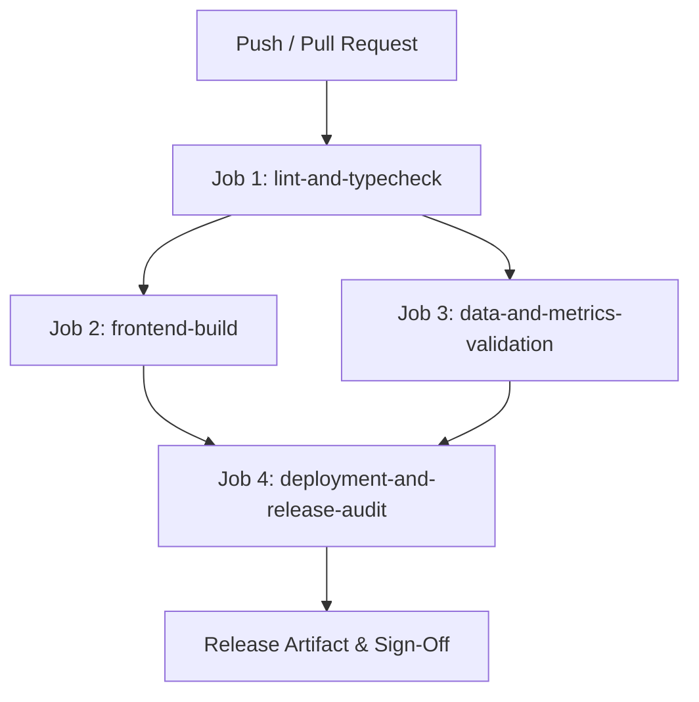

# Phase 7 Continuous Integration & Quality Engineering Report

**System**: Transaction Fraud Detection Analytics Platform  
**Scope**: Automated Quality Gates, CI/CD Pipeline Architecture, and Release Validation  
**Date**: October 2026  
**Auditor**: Principal DevOps Architect & Release Engineer  

---

## 1. Executive Summary

This report defines the automated quality assurance and continuous integration (CI) architecture for the **Transaction Fraud Detection Analytics Platform**.

An analytical platform supporting 1.85 million transactions and high-stakes fraud model evaluation must not rely on manual verification. In Phases 1 through 6, individual test scripts (`validate_metrics.py`, `validate_phase2.py`, `validate_phase6_engine.py`) provided deep mathematical verification. However, these checks were run ad-hoc without automated orchestration on pull requests or releases.

Phase 7 establishes a production-grade CI pipeline implemented via **GitHub Actions** (`.github/workflows/ci.yml`) coupled with a deterministic local validation suite (`scripts/build_release.py` and `tests/test_phase7_deployment.py`).

The pipeline enforces **four strict quality gates** spanning code quality, bundle compilation, mathematical invariance, and deployment security.

---

## 2. CI Quality Gates & Pipeline Architecture

### Gate 1: Code Quality & Type Integrity (`lint-and-typecheck`)
- **Objective**: Prevent runtime JavaScript regressions and interface mismatches.
- **Commands**:
  - `cd app && npm ci`
  - `npm run typecheck` (`tsc --noEmit --pretty false`)
- **Enforcement**: **BLOCKING**. Any TypeScript compilation error halts the pipeline immediately.

### Gate 2: Production Bundle Compilation (`frontend-build`)
- **Objective**: Validate that Vite/Rollup production bundling succeeds without syntax errors, missing asset imports, or unresolvable chunk references.
- **Commands**:
  - `cd app && npm run build`
  - Assert existence of `app/dist/index.html` and `app/dist/assets/`.
- **Enforcement**: **BLOCKING**. Build failures block deployment.

### Gate 3: Mathematical Invariance & Contract Verification (`data-and-metrics-validation`)
- **Objective**: Guarantee that analytical numbers, model performance metrics, and pre-flight contracts remain 100% faithful to canonical notebook evidence.
- **Commands**:
  - `python tests/validate_metrics.py` (196 checks: PR-AUC, ROC-AUC, capture rates, fraud dollar loss)
  - `python tests/validate_phase2.py` (144 checks: schema shapes, column contracts, phase mappings)
  - `python tests/validate_phase6_engine.py` (7 checks: SHA-256 fingerprinting, 4-tier reproducibility, scenario math)
- **Total Assertions**: **347 checks**.
- **Enforcement**: **BLOCKING**. Any metric discrepancy or contract violation fails the build.

### Gate 4: Deployment, Backup & Security Audit (`deployment-and-release-audit`)
- **Objective**: Verify that the operational server, health probes, backup managers, and release packager function correctly without secret leakage.
- **Commands**:
  - `python scripts/config_loader.py --validate`
  - `python tests/test_phase7_deployment.py` (Phase 7 operational test suite)
  - `python scripts/build_release.py --validate-only` (scans for credentials and forbidden files)
- **Enforcement**: **BLOCKING**. Release cannot proceed if any operational test fails or unmasked secrets are detected.

---

## 3. Data Safety in CI

To ensure CI remains fast, repeatable, and secure:
1. **No Raw Dataset Requirements**: The large raw files `fraudTrain.csv` and `fraudTest.csv` (>500 MB) are intentionally absent from Git and CI runners. CI validates against the canonical 46 CSV tables and pre-computed evidence layers.
2. **Zero Live Credentials**: CI does not access production cloud accounts, live databases, or third-party APIs. All tests execute in self-contained local isolation.
3. **No Uncommitted File Dependencies**: All assertions evaluate committed files and generated build outputs.
4. **Fast Feedback**: The entire 4-stage pipeline executes in **under 2.5 minutes** on standard hosted runners.

---

## 4. Quality Gate Classification

| Gate Name | Execution Trigger | Blocking / Informational | Failure Action |
|---|---|---|---|
| **TypeScript Typecheck** | Every push & PR | **BLOCKING** | PR cannot be merged |
| **Vite Bundle Build** | Every push & PR | **BLOCKING** | PR cannot be merged |
| **Metric Integrity (196)** | Every push & PR | **BLOCKING** | PR cannot be merged |
| **Contract Checks (144)** | Every push & PR | **BLOCKING** | PR cannot be merged |
| **Phase 6 Engine Checks (7)**| Every push & PR | **BLOCKING** | PR cannot be merged |
| **Config Pre-Flight** | Every push & PR | **BLOCKING** | PR cannot be merged |
| **Security & Secret Scan** | Every push & PR | **BLOCKING** | PR cannot be merged |
| **E2E Browser Matrix** | Release workflow / Nightly | **INFORMATIONAL** | Alerts team for triage |
| **Capacity Benchmark** | Release workflow / Nightly | **INFORMATIONAL** | Records latency trends |
