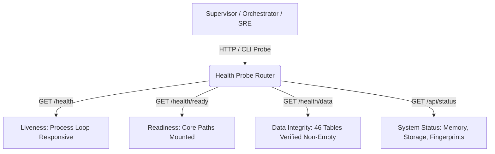

# Phase 7 Observability, Health Monitoring & Operational Architecture

**System**: Transaction Fraud Detection Analytics Platform  
**Scope**: Health Probe Design, Operational Dashboard, Structured JSON Logging, and Real-Time Diagnostics  
**Date**: October 2026  
**Auditor**: Principal Platform Architect, SRE Lead & Observability Engineer  

---

## 1. Executive Summary

This report defines the comprehensive observability and operational diagnostics architecture implemented for the **Transaction Fraud Detection Analytics Platform**.

A production analytics console handling 1.85 million transactions and supporting high-stakes risk decisions cannot rely on simple process-existence checks. Prior to Phase 7, the platform operated without structured machine-readable logs or formal health probes.

Phase 7 introduces a **three-tier observability system**:
1. **Multi-Probe Health Architecture**: Formal separation of Process Liveness (`/health`), Dependency Readiness (`/health/ready`), and Data Layer Integrity (`/health/data`).
2. **Standardized Structured Logging (`scripts/structured_logger.py`)**: JSON Lines format emitting operation IDs, durations, event categories, and outcomes, with automated redaction of sensitive tokens.
3. **In-Console Operational Dashboard (`/operations`)**: Real-time browser-accessible operations view displaying live probe telemetry, master SHA-256 fingerprint, data layer inventory, storage consumption, and diagnostic event logs.

---

## 2. Health Monitoring & Probe Architecture



### 2.1 Liveness Probe (`/health`)
- **Question Answered**: *Is the server process running, scheduling I/O, and able to respond to requests?*
- **Implementation**: Handled in `scripts/server.py` and `scripts/health_check.py`.
- **Response Format**:
  ```json
  {
    "status": "ok",
    "service": "fraud-analytics-console",
    "timestamp": "2026-10-21T18:00:36.300099+00:00",
    "uptime_seconds": 142.50
  }
  ```
- **HTTP Status Code**: `200 OK` (or socket timeout/connection refused if crashed).

### 2.2 Readiness Probe (`/health/ready`)
- **Question Answered**: *Are all required persistent volumes, mounted paths, and essential configuration loaded?*
- **Checks Executed**:
  1. `DATA_DIR` exists and is readable (`app/public/data/`).
  2. `manifest.json` exists in `DATA_DIR`.
  3. `TABLES_DIR` exists (`tables/`).
- **HTTP Status Code**: `200 OK` if ready; `503 Service Unavailable` if core paths are missing.

### 2.3 Data Readiness Probe (`/health/data`)
- **Question Answered**: *Are the 46 canonical CSV analytical evidence tables intact, readable, and non-empty? Are historical snapshots accessible?*
- **Checks Executed**:
  1. Iterates over all 46 CSV tables in `tables/`. Asserts table count $\ge 40$.
  2. Asserts file size $> 0$ bytes for each table. Flags any zero-byte files.
  3. Audits presence of historical snapshot checkpoints in `app/public/data/snapshots/`.
- **HTTP Status Code**: `200 OK` (healthy); `503 Service Unavailable` (degraded/missing data).

---

## 3. Operational Dashboard (`/operations`)

The in-app Operations page provides operators and reviewers with instant visual inspection of system health:
1. **System Health Banner**: Live status indicator (`ALL OPERATIONAL SYSTEMS HEALTHY` vs `DEGRADED`), operating environment mode, target host, and master SHA-256 fingerprint.
2. **Key Metric Cards**: Liveness status, Readiness status, Table integrity (46/46 verified), Snapshot checkpoints (3 immutable records).
3. **Persistence Architecture Table**: Classifies original sources (46 CSVs), figure artifacts (129 PNGs + 7 HTML maps), derived JSON layers (46 JSONs), snapshots, and Power BI pack (71 CSVs / 137 DAX).
4. **Storage & Capacity Profiling**: Displays disk consumption by directory (`figures/` 32.4 MB, `data/` 12.8 MB, `dist/` 1.4 MB, `logs/` 1.2 MB, `tables/` 0.4 MB) against configured storage limits (48.2 MB / 500 MB = 9.6%).
5. **Interactive Actions**:
   - `Run Live Diagnostics`: Dispatches live probe re-evaluation across memory and data tables.
   - `Clear Cache`: Evicts in-memory client data cache and reloads manifest.

---

## 4. Structured JSON Logging Architecture

### 4.1 Schema Specification
Logs are emitted to `logs/operational.jsonl` and stdout using the following structured schema:

| Field | Type | Description |
|---|---|---|
| `timestamp` | ISO-8601 String | UTC timestamp with microsecond precision |
| `level` | String | Severity: `DEBUG`, `INFO`, `WARNING`, `ERROR`, `CRITICAL` |
| `logger` | String | Logger identifier (e.g. `fraud-analytics`) |
| `category` | String | Event domain: `server_start`, `health_probe`, `data_refresh`, `backup`, `api` |
| `message` | String | Concise, human-readable description |
| `operation_id` | String (Optional) | Unique correlation ID for tracing operations |
| `duration_ms` | Float (Optional) | Measured execution time in milliseconds |
| `outcome` | String | `success`, `warning`, `failure` |
| `details` | Object (Optional) | Contextual metadata with sensitive keys masked |

### 4.2 Automated Redaction & Data Privacy
The logger automatically intercepts and redacts any key containing `password`, `secret`, `token`, `key`, `authorization`, `cookie`, `card`, `ccv`, or `ssn`, replacing the value with `"******"`. Private personal identifying information is never written to log files.
