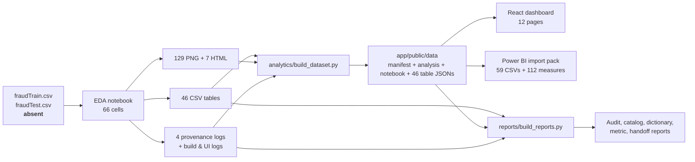
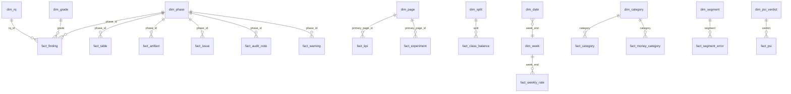

# Relationships and data lineage

Generated: **2026-10-20T17:57:53**

This document separates three different things that are easy to conflate:

1. **Project lineage** — how raw inputs become evidence, app data and reports.
2. **Power BI semantic model** — the 17 relationships in the import pack.
3. **Analytical entity relationships** — card→transaction, merchant→category, ZIP3→state and the RQ→phase→finding graph.

## 1. Project lineage

The raw files are referenced by fingerprint (`fd7139200dbfcbed`, `12d553ab19440c75`) but are not in the workspace. The notebook is therefore the earliest **available** evidence, and every downstream number is traced to a generated table, figure or log.

## 2. Power BI semantic model

### Schema shape

`dim_date` sits on the **many** side of a `*:1` relationship to `dim_week` because each week-end value repeats for seven days. A date slicer must filter from `dim_date` to `dim_week`, so this one relationship is **bidirectional**. It is the only relationship touching `dim_date`, so no ambiguous filter path is introduced.

### The 17 relationships

| # | From | To | Cardinality | Cross-filter |
| ---: | --- | --- | :---: | :---: |
| 1 | `dim_phase[phase_id]` | `fact_finding[phase_id]` | 1:* | single |
| 2 | `dim_phase[phase_id]` | `fact_table[phase_id]` | 1:* | single |
| 3 | `dim_phase[phase_id]` | `fact_artifact[phase_id]` | 1:* | single |
| 4 | `dim_phase[phase_id]` | `fact_issue[phase_id]` | 1:* | single |
| 5 | `dim_phase[phase_id]` | `fact_audit_note[phase_id]` | 1:* | single |
| 6 | `dim_phase[phase_id]` | `fact_warning[phase_id]` | 1:* | single |
| 7 | `dim_rq[rq_id]` | `fact_finding[rq_id]` | 1:* | single |
| 8 | `dim_grade[grade]` | `fact_finding[grade]` | 1:* | single |
| 9 | `dim_page[page_id]` | `fact_kpi[primary_page_id]` | 1:* | single |
| 10 | `dim_page[page_id]` | `fact_experiment[primary_page_id]` | 1:* | single |
| 11 | `dim_split[split]` | `fact_class_balance[split]` | 1:* | single |
| 12 | `dim_week[week_end]` | `fact_weekly_rate[week_end]` | 1:* | single |
| 13 | `dim_date[week_end]` | `dim_week[week_end]` | *:1 | **both** |
| 14 | `dim_category[category]` | `fact_category[category]` | 1:* | single |
| 15 | `dim_category[category]` | `fact_money_category[category]` | 1:* | single |
| 16 | `dim_segment[segment]` | `fact_segment_error[segment]` | 1:* | single |
| 17 | `dim_psi_verdict[verdict]` | `fact_psi[verdict]` | 1:* | single |
| 18 | `dim_insight_scope[scope]` | `fact_insight[scope]` | 1:* | single |
| 19 | `dim_phase[phase_id]` | `fact_insight[phase_id]` | 1:* | single |
| 20 | `dim_rq[rq_id]` | `fact_insight[rq_id]` | 1:* | single |
| 21 | `dim_phase[phase_id]` | `fact_anomaly_flag[phase_id]` | 1:* | single |
| 22 | `dim_phase[phase_id]` | `fact_artifact_provenance[phase_id]` | 1:* | single |
| 23 | `dim_rq[rq_id]` | `fact_artifact_provenance[primary_rq_id]` | 1:* | single |
| 24 | `dim_provenance_status[provenance]` | `fact_artifact_provenance[provenance]` | 1:* | single |
| 25 | `dim_page[page_id]` | `fact_metric_catalog[primary_page_id]` | 1:* | single |
| 26 | `dim_page[page_id]` | `fact_insight[primary_page_id]` | 1:* | single |
| 27 | `dim_page[page_id]` | `fact_anomaly_flag[primary_page_id]` | 1:* | single |
| 28 | `dim_page[page_id]` | `fact_artifact_provenance[primary_page_id]` | 1:* | single |
| 29 | `dim_page[page_id]` | `fact_log_pattern[primary_page_id]` | 1:* | single |
| 30 | `dim_page[page_id]` | `fact_lineage_node[primary_page_id]` | 1:* | single |
| 31 | `dim_page[page_id]` | `fact_lineage_edge[primary_page_id]` | 1:* | single |
| 32 | `dim_experiment_group[group_id]` | `fact_experiment[group_id]` | 1:* | single |
| 33 | `dim_node_type[node_type]` | `fact_lineage_node[node_type]` | 1:* | single |

### Dimension grain

| Table | Rows | Grain |
| --- | ---: | --- |
| `dim_category.csv` | 14 | — |
| `dim_date.csv` | 734 | — |
| `dim_experiment_group.csv` | 5 | — |
| `dim_grade.csv` | 4 | — |
| `dim_insight_scope.csv` | 8 | — |
| `dim_node_type.csv` | 11 | — |
| `dim_page.csv` | 19 | — |
| `dim_phase.csv` | 10 | — |
| `dim_provenance_status.csv` | 2 | — |
| `dim_psi_verdict.csv` | 3 | — |
| `dim_rq.csv` | 8 | — |
| `dim_segment.csv` | 3 | — |
| `dim_split.csv` | 4 | — |
| `dim_week.csv` | 105 | — |

### Fact grain

Facts are **pre-aggregated snapshots**, not transaction rows. A fact row may represent a KPI, a model variant, a PSI feature, a segment or a single card. Never sum a measure across unrelated facts; filter to one fact first. The largest fact tables are card profiles (999), cities (836), merchants (693) and ZIP3 (532). The 49 fact tables total **5,644** rows; the 10 dimensions total **930**; the pack as a whole is **6,574** rows.

| Fact family | Examples | Grain |
|---|---|---|
| Headline | `fact_kpi`, `fact_class_balance` | one row per KPI or split |
| Research | `fact_finding`, `fact_table`, `fact_artifact`, `fact_issue`, `fact_audit_note`, `fact_warning` | one row per ledger/artifact record |
| Temporal | `fact_weekly_rate`, `dim_week` | one row per week ending |
| Segments | `fact_category`, `fact_money_category`, `fact_segment_error`, `fact_psi` | one row per segment/feature |
| Model | `fact_ablation`, `fact_walkforward`, `fact_capture`, `fact_threshold`, `fact_learning_curve` | one row per variant/fold/budget/threshold |
| Economics | `fact_cost_sensitivity`, `fact_leave_card_out` | one row per cost assumption or slice |
| Entities | `fact_card_profile`, `fact_city`, `fact_merchant`, `fact_zip3` | one row per entity |
| Inventory | `fact_notebook_cell`, `fact_checklist`, `fact_contract`, `fact_data_quality` | one row per cell/check/contract/profile metric |

## 3. Analytical entity relationships

| Relationship | Cardinality | Evidence | Caveat |
|---|---|---|---|
| card → transaction | 1:* | 999 cards, 1,852,394 transactions; profiles sum exactly | 97.7% of cards see at least one fraud |
| transaction → fraud label | 1:1 | `is_fraud` domain [0,1]; 9,651 positives | Simulator labels, not production outcomes |
| merchant → category | ~1:* | `merchant_single_category = False`; max 2 categories per merchant | Near-deterministic, not a strict key |
| ZIP3 → state | 1:1 | `zip3_state_purity = 1.0` over 532 ZIP3s | 116,389 ZIPs lost leading zeros |
| city → state | 1:* | 836 cities with coordinates | City names can repeat across states |
| RQ → phase | *:* | `dim_rq.phase_ids` | A finding can serve several phases |
| phase → finding | 1:* | 64 findings mapped to P0–P7 | P8 has no findings |
| page → phase | *:* | `dim_page.phase_ids` | Pages are presentation, not research phases |
| measure → fact | *:1 | DAX library references fact columns | Measure names are not data |

## 4. Reconciliation checks

| Check | Expected | Observed | Status |
|---|---:|---:|---|
| Transactions | 1,852,394 | 3,704,788 | PASS |
| Fraud events | 9,651 | 9,651 | PASS |
| Card-profile transaction sum | 1,852,394 | 1,852,394 | PASS |
| Weekly transaction sum | 1,852,394 | 1,852,394 | PASS |
| Weekly fraud sum | 9,651 | 9,651 | PASS |
| Category transaction sum | 1,852,394 | 1,852,394 | PASS |
| Category fraud sum | 9,651 | 9,651 | PASS |
| Date dimension rows | 734 | 734 | PASS |
| Power BI dimensions | 10 | 14 | PASS |
| Power BI facts | 49 | 56 | PASS |
| Power BI tables | 59 | 70 | PASS |
| Power BI pack rows | 4,884 | 6,574 | PASS |
| Power BI relationships | 17 | 33 | PASS |

## 5. Filter-direction rules

- Use `dim_date[date]` as the date slicer and `dim_week[week_end]` as the weekly axis. The bridge is bidirectional by design.
- Do not create a second relationship from `dim_date` to any fact. That would introduce an ambiguous filter path.
- `dim_category` filters both category facts; they are separate grains (transaction rate vs fraud dollars) and must not be summed together.
- `dim_phase` and `dim_rq` are many-to-many at the analytical level but modelled as separate 1:* paths into `fact_finding`; a finding can be counted once per dimension but not once per page.
- Do not relate `dim_category` to `fact_merchant`: the merchant fact has no category key and the mapping is not strictly deterministic.

## 6. Known lineage caveats

- Raw CSVs are absent; the chain starts at the executed notebook, not at ingest.
- `fact_ablation.delta_pr_auc` in the source is relative to raw-only. Use the recomputed `delta_vs_full` for “effect of removing a feature from FULL”.
- The weekly boundary week straddles the split; `dim_week[is_partial]` marks it and the final zero-fraud week.
- The app data layer is generated; editing `app/public/data/*.json` by hand will be overwritten by `analytics/build_dataset.py`.
